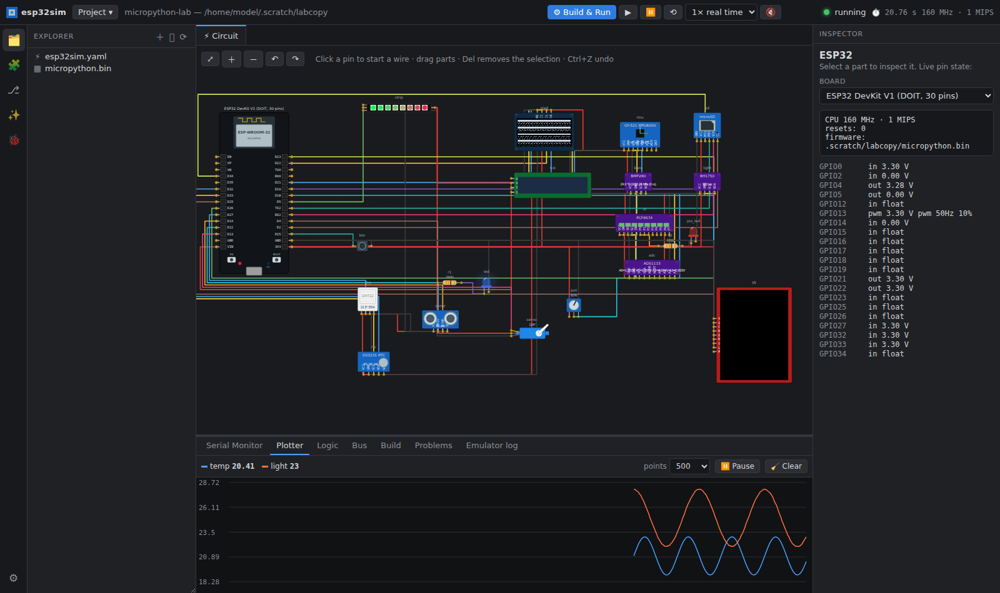

# esp32sim: ESP32 board emulator, circuit simulator and IDE

esp32sim runs **real ESP32 firmware images** (the `.bin`/`.elf` that PlatformIO,
arduino-cli or ESP-IDF produce) on an emulated dual-core Xtensa LX6. The
emulated chip is wired to a **simulated circuit** that you describe in YAML or
draw in the browser: LEDs, resistors, buttons, displays, sensors, I2C/SPI
modules, motors and more. It is written in Rust and has:

* a **command-line console**: serial monitor plus `/commands` to press buttons,
  turn knobs and look at displays;
* a **headless test runner**: scripted scenarios with pass/fail, for CI;
* a **GUI**, in the browser or as a **desktop app** (Tauri): circuit editor,
  live simulation view, Monaco code editor with clangd IntelliSense,
  PlatformIO build, source-level debugger, git and an AI assistant.

The goal is to get firmware and wiring working, with tests, before you touch a
breadboard.



```
crates/xtensa-core   Xtensa LX6 interpreter (windowed ABI, loops, FPU, MAC16, interrupts), decoder, disassembler
crates/esp32-soc     ESP32 SoC: memory map, flash/MMU, peripherals, ROM HLE, boot, dual-core scheduler
crates/devices       circuit model: netlist, DC + RC solver, 85+ part models, YAML project format
crates/esp32sim      the `esp32sim` library + binary: console, test runner, web server/IDE backend
web/                 GUI (vanilla JS + Monaco + xterm.js), embedded in the binary
desktop/             desktop app (Tauri 2) around the same engine and GUI
ui-tests/            GUI tests: JavaScript unit tests (node) and end-to-end tests (Playwright)
scripts/test.sh      runs the test suites (see "Testing")
examples/            ready-to-run projects with real firmware and test scenarios
```

## Download

Desktop installers for macOS, Windows and Linux are on the
[releases page](https://github.com/bloodf/esp32sim/releases/latest):
`.dmg` (macOS, Apple Silicon and Intel), `.msi` / `-setup.exe` (Windows),
`.AppImage` / `.deb` / `.rpm` (Linux). The builds are not code-signed yet; on
macOS run `xattr -cr /Applications/esp32sim.app` if it refuses to open.

To publish a new release, bump the version in
`desktop/src-tauri/tauri.conf.json` and push a tag: `git tag v0.1.1 && git push --tags`.

## Requirements

* **Rust.** A recent stable toolchain to build it (1.85 or newer; developed
  with 1.91).
* **PlatformIO, to compile firmware in the IDE.** Install it with
  `pip install platformio`. The first build downloads the ESP32 toolchain and
  the Arduino core. You can use `arduino-cli` instead.
* **clangd, optional, for IntelliSense.** Install it with `pip install clangd`
  or from your distribution. `git` is optional too, for the source-control
  panel.
* **A browser** for the GUI, or the desktop app (see `desktop/README.md`;
  Rust 1.90+, and the WebKitGTK packages on Linux).
* **Node.js 18+** only to run the GUI tests.

Prebuilt firmware images (`.bin`/`.elf`) run without any of the optional tools.

## Quick start

```sh
cargo build --release            # binary: target/release/esp32sim

# run real firmware against a circuit, with an interactive serial console
./target/release/esp32sim run examples/micropython-lab
>>> print("hello")               # typed lines go to UART0
/show oled                       # console commands start with '/'

# run a project's test scenario headless (exit code 0 = pass)
./target/release/esp32sim test examples/micropython-modules

# the GUI (opens a browser; --no-browser to just serve http://127.0.0.1:8732/)
./target/release/esp32sim gui examples/arduino-serial-io

# the same GUI as a desktop app (native window, menus and file dialogs)
cargo run --release --manifest-path desktop/src-tauri/Cargo.toml -- examples/arduino-serial-io

# new PlatformIO project + circuit + test (templates: blink, button, oled, lcd,
# keypad, neopixel, sensors, nfc, rfid, sdlogger, gps)
./target/release/esp32sim new ~/esp32-projects/blink --template blink
cd ~/esp32-projects/blink && pio run && esp32sim run .
```

Other commands:

* `esp32sim parts` lists every part type.
* `esp32sim parts ssd1306` shows one part's pins and properties.
* `esp32sim info firmware.bin` shows the partition table and image segments.

### Included examples

| example | firmware | what the test checks |
|---|---|---|
| `arduino-serial-io` | Arduino-ESP32 2.x sketch (IDF 4.4) | serial protocol, LED, relay, ADC from a potentiometer, DHT11 |
| `micropython-lab` | MicroPython 1.23 (IDF 5.0) | I2C scan, MPU6050, BMP280, PCF8574, ADS1115, BH1750, SSD1306, NeoPixels, DHT22, HC-SR04, servo PWM, SoftI2C DS3231, ILI9341 TFT over SPI, microSD (FAT) write/read, light sleep, deep sleep woken by a button (EXT0) with RTC memory kept |
| `micropython-modules` | MicroPython 1.23 | two DS18B20 on one 1-Wire bus, HX711 load cell, MFRC522 RFID (read/write a MIFARE block), INA219, L298N, A4988, 28BYJ-48, NEC IR remote decoded from pin interrupts, GPS NMEA over UART, HC-05 AT mode and phone link |
| `rust-esp-hal` | bare-metal Rust (esp-hal, no IDF) | blinky on GPIO15; `hello.elf` has full DWARF and is used for the debugger tests |

## Project file (`esp32sim.yaml`)

```yaml
name: weather-station
board: esp32-devkit-v1          # or esp32-devkitc, nodemcu-32s
firmware: .pio/build/esp32dev/firmware.bin   # .bin (app or merged image) or .elf
elf: .pio/build/esp32dev/firmware.elf        # optional: symbols + source-level debugging
# partitions: partitions.bin    # optional (PlatformIO's is picked up automatically)
# flash_size: 4MB
speed: 1.0                      # 1 = real time, 0 = as fast as possible
components:
  - {id: oled, type: ssd1306, address: 0x3C}
  - {id: dht, type: dht22, temperature: 21.5, humidity: 55}
  - {id: r1, type: resistor, value: 330}
  - {id: led, type: led, color: blue}
  - {id: btn, type: pushbutton}
connections:
  - [esp32.D21, oled.SDA]                  # a pair...
  - [esp32.D22, oled.SCL]
  - [3V3, oled.VCC, dht.VCC]               # ...or a whole net
  - [GND, oled.GND, dht.GND, led.C, btn.2]
  - "esp32.D27 - dht.SDA"                  # text form
  - {from: esp32.D4, to: r1.1, color: "#ff7043", points: [[300, 200]]}   # GUI wire
  - [r1.2, led.A]
  - [esp32.D15, btn.1]
test:                                      # optional scenario for `esp32sim test`
  - expect_serial: "ready"
  - press: btn
  - expect: {id: led, brightness: ">0.5", within: 200ms}
```

* **Pins.** ESP32 pins can be written as `esp32.D4`, `esp32.GPIO4`, `esp32.4`,
  `D4` or `GPIO4`. The rails are `GND`, `3V3` and `5V` (`VIN`). Part pins are
  `<id>.<PIN>`; the GUI and `esp32sim parts` show the pin names.
* **Board extras.** The board has an on-board LED on GPIO2 (DevKit V1) and a
  BOOT button on GPIO0 with its pull-up. I2C breakout boards carry 10 kΩ
  pull-ups, as real modules do.
* **Electrical model.** Each connected group of nets is solved with DC nodal
  analysis. ESP32 pads have their real push-pull, open-drain and pull-up/down
  behaviour. LEDs follow their current, and an LED with no series resistor
  burns out. Potentiometers, LDRs and NTCs give real divider voltages at the ADC.

### Test scenario steps

| step | meaning |
|---|---|
| `expect_serial: "text"` | wait until the serial output contains the text (`timeout: 10s` by default) |
| `send: "text\r"` | send to UART0 (YAML escapes apply; then `\n \r \t \\` in the text, so `"\\\\n"` sends a literal `\n` to Python) |
| `send_file: path` / `paste: path` | send a file; `paste` wraps it in MicroPython paste mode (Ctrl-E … Ctrl-D) |
| `wait: 500ms` | let emulated time pass |
| `press` / `release` / `click` / `toggle: id` | button and switch actions |
| `set` / `input: {id: x, ...}` | any part action, e.g. `{id: dht, temperature: 30}`, `{id: kp, type: "1234#"}`, `{id: rfid, action: tap, card: mifare, uid: "DE:AD:BE:EF"}` |
| `expect: {id: x, key: value, within: 1s}` | check part state: numbers, `">0.5"`, `"<=3"`, `"!=0"`, nested keys like `"pixels[0]": "ff0000"`, or `contains: "text"` |
| `log: "text"` | print a note |

## Parts

Run `esp32sim parts` for the full list with descriptions. Each part has a
visual in the GUI, and the interactive ones have controls: press buttons, type
on keypads, tap NFC/RFID cards, move sliders for sensor values.

**Output**: `led`, `rgb-led`, `buzzer` (passive, plays sound in the GUI), `buzzer-active`, `relay`, `servo`, `ws2812` (NeoPixel strips/rings/matrices via RMT or bit-bang), `l298n` (2 DC motors), `a4988` (NEMA17 stepper), `uln2003` (28BYJ-48)

**Input**: `pushbutton` (optional bounce), `touch-pad` (electrode on a touch pin: `touchRead()` / `TouchPad`), `switch`, `slide-switch`, `potentiometer`, `keypad-4x4`, `keypad-4x3`, `joystick`, `rotary-encoder` (KY-040), `ir-receiver` (VS1838B + clickable 21-key NEC remote), `signal` (voltage source)

**Passive**: `resistor`, `capacitor` (charges through the circuit: RC delays, debouncing, PWM filters)

**Sensors**: `ldr`, `ntc`, `pir`, `ir-obstacle`, `touch-sensor`, `hall-sensor`, `vibration-sensor`, `tilt-sensor`, LM393 modules (`soil-moisture`, `mq2`, `sound-sensor`, `flame-sensor`, `rain-sensor`) and `water-level`, `dht11`, `dht22`, `ds18b20` (1-Wire, several per bus), `hc-sr04`, `hx711` (load cell), `bh1750`, `sht31`, `aht20`, `bmp280`, `bme280`, `bmp180`, `ms5611`, `mpu6050`, `mpu9250` (9DOF, AK8963), `adxl345`, `hmc5883l`, `qmc5883l`, `gy-86` / `gy-87` / `gy-91` (10DOF flight-controller boards)

**Displays**: `ssd1306` / `sh1106` (I2C or SPI OLED), `lcd1602-i2c`, `lcd2004-i2c` (PCF8574 backpack), `lcd-parallel` (HD44780 4/8-bit), `ili9341`, `st7735`, `st7789` (SPI TFT), `max7219`, `tm1637`, `7segment`

**I2C modules**: `pcf8574` / `pcf8574a` / `pcf8574t`, `pcf8575`, `mcp23017`, `i2c-relay`, `ads1115`, `ads1015`, `mcp3421`, `at24c` (EEPROM), `ina219` (measures the simulated current through its shunt), `ds3231`, `ds1307`

**Serial modules**: `gps-neo6m` (NMEA at 9600 baud; set position, speed and fix), `hc-05` (Bluetooth SPP: AT commands, then a phone terminal in the inspector)

**Storage**: `sd-card` (SPI microSD, SDHC/FAT32 image in `.esp32sim/<id>.img`; the files your firmware writes are listed in the inspector)

**RFID/NFC**: `pn532` (I2C, MIFARE Classic and NTAG213 with NDEF text), `mfrc522` (SPI, register-level; REQA/anticollision/select, MIFARE auth/read/write, NTAG read/write)

**Logic**: `74hc595`

Protocols are decoded the way the hardware sees them. I2C works on both
hardware controllers and bit-banged SoftI2C. SPI and RMT are routed through
the GPIO matrix. DHT, DS18B20 (1-Wire), HX711, HC-SR04 and WS2812 are timed
waveforms, and LEDC drives PWM for servos, LED dimming and buzzers.

## Console commands (`esp32sim run`)

```
/parts                 list components and their state      /pins      pin voltages and modes
/show <id>             render a part (OLED/LCD as text art, LEDs, pixels, ...)
/press /release /click /toggle <id>                          /key <id> 5   /type <id> 1234#
/set <id> 0.3          pot position, sensor value, weight…  /set imu roll=30 pitch=10
/tap <id> [uid] [ntag] present an NFC/RFID card             /remove <id>
/turn <id> <steps>     rotary encoder                       /input <id> <json>
/send <file>           send a file                          /paste <file>  MicroPython paste mode
/bus [n]               last n I2C/SPI/UART/RMT transactions (address, ACK/NACK, bytes)
/pause /resume /reset /speed <x> /status /quit
```

The line ending for typed lines is LF by default. It switches to CR
automatically once MicroPython's banner is seen; `--eol` overrides this.

## The GUI / IDE

`esp32sim gui [project]` serves the IDE on localhost. It has these parts:

* **Circuit.** Drag parts from the 🧩 palette, click a pin and then another
  pin to wire them, and drag to move. Wires route around the board. The
  inspector shows live state, properties and controls (sliders, buttons, card
  tap). Changes are saved to `esp32sim.yaml` and the simulation restarts;
  Ctrl+Z / Ctrl+Shift+Z undo and redo. Editing `esp32sim.yaml` as text updates
  the drawing too.
* **Simulation view.** Displays, LEDs, NeoPixels, servos, motors and gauges
  update live. You can click buttons and keypads on the drawing, and the
  buzzer is audible. It also has an xterm serial monitor (you can type
  straight into it), run/pause/reset controls, and a speed control from 0.1×
  to unlimited.
* **Serial plotter.** Numbers printed on a line are plotted live, as in the
  Arduino IDE. Labelled values like `temp:21.5 hum:40` are supported.
* **Logic analyzer.** Records level changes of every ESP32 pin wired into the
  circuit. Zoom with the wheel, pan by dragging, and click twice to measure
  time and frequency between cursors. It shows pin-level traffic: GPIO writes,
  bit-banged protocols (SoftI2C, DHT, 1-Wire, HX711, keypad scans…) and the
  parts' responses. Hardware peripherals (UART, I2C, SPI, RMT, LEDC) are
  modelled at transaction level, so their traffic does not appear as edges.
* **Bus monitor.** A transaction log of the hardware buses. I2C rows show the
  address, read or write, ACK/NACK, the data and the part that answered. SPI
  rows show MOSI/MISO bytes per device, UART shows lines in both directions,
  and RMT shows pulse trains. A NACK from a missing or mis-addressed module
  shows up in red.
* **Editor.** Monaco with tabs, a file tree, and IntelliSense and diagnostics
  from **clangd**:
  * Before the first build, bundled Arduino-ESP32 API headers plus your
    `include/`, `src/` and `lib/` give completion straight away.
  * After a PlatformIO build, the real `compile_commands.json` is used.
* **Build & Run.** `pio run` (or `arduino-cli compile` for sketch folders).
  Compiler errors go to a Problems list and editor squiggles, and the new
  firmware loads into the simulator.
* **Debugger.** Gutter breakpoints resolve through the ELF's DWARF line table.
  It has continue/pause, step into, step over and single-instruction step, a
  call stack, and **local variables**. Locals are read from DWARF location
  expressions and location lists, and shown as scalars, pointers, strings,
  arrays and structs. There are also registers, disassembly, watches of
  global variables, and a memory viewer. Both cores can be inspected.
* **Git.** Status, stage, unstage and discard, diffs against HEAD, commit,
  branches, history, remotes, and push/pull.
* **AI assistant.** Works with OpenAI, Anthropic, Gemini, Ollama or any
  OpenAI-compatible endpoint (OpenRouter, Groq, LM Studio…).
  * It receives the open file, the selection, the circuit YAML, build errors
    and the serial output.
  * Quick actions: Explain, Find bugs, Improve, Fix build, Check wiring and
    Write tests.
  * Any code block it returns can be previewed as a diff and applied with
    one click.
  * The editor's context menu has Explain, Find bugs, Improve and Document
    for the selection.
  * Inline completions (ghost text, Tab to accept) can be turned on in
    Settings.
  * Set keys in ⚙ Settings. They are stored in
    `~/.config/esp32sim/settings.json` and never sent to the browser.

Tools are found on `PATH` or in `~/.platformio/penv`; their paths can also be
set in Settings (`pip install platformio clangd` provides both).

## What is emulated

* **CPU.** Xtensa LX6 with the windowed register ABI (lazy overflow and
  underflow exceptions), zero-overhead loops, the ESP32 interrupt levels, the
  timers (CCOUNT/CCOMPARE), the single-precision FPU (including the
  divide/sqrt helper instructions) and MAC16. Both cores run, and the APP CPU
  is started by the firmware as on real hardware.
* **Memory.** Internal SRAM/IRAM/DRAM, RTC memory, and external flash through
  the cache MMU, with partition table and OTA data handling.
* **Peripherals.** UART0-2, GPIO/IO_MUX/GPIO matrix/RTC IO, interrupt matrix,
  timer groups and watchdogs, the legacy FRC timers, RTC_CNTL, SAR ADC1/2, DAC, capacitive touch, LEDC, RMT, I2C0/1,
  SPI1 (flash) and SPI2/3 (master, DMA), eFuse (MAC address), and enough of the
  radio and clock registers for firmware to boot.
* **Sleep.** Light and deep sleep wake on the RTC timer, EXT0 or EXT1. Deep
  sleep resets with `DEEPSLEEP_RESET` and keeps RTC memory. Sleeping costs no
  CPU: it passes in real time in the GUI and instantly in tests.
* **Boot ROM.** About 250 ROM functions (libc, soft-float, cache/flash, CRC,
  MD5, printf…) are implemented natively, so no ROM dump is needed.
* **Firmware.** Checked with Arduino-ESP32 2.x (ESP-IDF 4.4), MicroPython
  1.23 (ESP-IDF 5.0), MicroPython 1.15 (ESP-IDF 4.0) and bare-metal Rust
  (esp-hal). Accepted formats are app `.bin`, merged flash images (offset 0x0
  or 0x1000) and `.elf`.

## Flash, resets and persistence

* **EN / reset button.** Resetting restarts the chip and keeps the flash
  contents and the circuit, as a real board does.
* **Data partitions persist.** NVS (Preferences), SPIFFS, LittleFS and FAT are
  saved to `.esp32sim/flash-data.bin` in the project folder. They are put back
  after restarts and after new builds, like a real board where uploading only
  rewrites the app. *Project ▸ Erase flash data* wipes them.
* **SD cards** are image files in `.esp32sim/` (see `sd-card`).
* **Test runs** (`esp32sim test`) always start from a clean flash and empty SD
  cards, so results are repeatable.

## Limitations

* **No Wi-Fi or Bluetooth.** Radio initialisation is tolerated, but the radio
  never connects.
* **One tested build doesn't boot.** A MicroPython 1.16 build on ESP-IDF 4.2
  crashes on core 1 at start-up, in an inter-core "DPORT stall" interrupt
  handler. The IDF 4.0, 4.4 and 5.0 builds boot.
* **Speed.** The interpreter runs about 40-60 MIPS on a desktop core. Idle
  time (`delay`, `vTaskDelay`, WFI) is skipped, so typical sketches run in real
  time, but CPU-bound code at 240 MHz runs slower than real time.
* **Floating point.** Subnormal single-precision quotients can differ by 1 ULP.
* **Electrical model.** Capacitors charge and discharge exponentially through
  the Thevenin resistance they see, which is enough for RC delays, debounce
  networks and PWM-to-analog filters. There is no inductance or AC analysis.

## Testing

Nothing in the test suites needs ESP32 hardware, a toolchain or network
access. Firmware is either a tiny **mock firmware** written in Xtensa
assembly and assembled at test time by the project's own assembler
(`xtensa_core::asm`), or a prebuilt example image. The circuit, the ESP32 side
of buses (I2C, SPI, UART, RMT, PWM) and the AI providers are mocked in the
tests.

```sh
scripts/test.sh              # Rust + JavaScript unit tests + GUI end-to-end tests (~5 min)
scripts/test.sh rust         # Rust unit + integration tests            (~10 s after building)
scripts/test.sh js           # GUI JavaScript unit tests                 (~15 s)
scripts/test.sh e2e          # GUI end-to-end tests in Chromium          (~4 min)
scripts/test.sh scenarios    # the example projects with real firmware   (~15 s)
scripts/test.sh desktop      # desktop shell tests (Tauri mock runtime)
scripts/test.sh all          # rust + js + e2e + scenarios
```

The same suites without the script:

```sh
cargo test --release --workspace                                        # rust
cargo test --release -p esp32sim --test scenarios -- --ignored          # scenarios
cd ui-tests && npm ci && npx playwright install chromium                # once
npm run test:unit                                                       # js
cargo build --release && npx playwright test                            # e2e (from ui-tests/)
cargo test --manifest-path desktop/src-tauri/Cargo.toml --no-default-features --features mock   # desktop
```

What the suites cover:

| suite | where | what |
|---|---|---|
| CPU | `crates/xtensa-core/tests` | assembler byte-exact against LLVM and round-trips with the disassembler over the whole instruction space; ISA semantics (ALU, shifts, multiply/divide, loads/stores, branches, loops, windowed calls with spills, exceptions, interrupts, timers, FPU, booleans) |
| SoC | `crates/esp32-soc/tests` | assembled firmwares boot on the full chip and drive a mock circuit: UART, GPIO in/out, GPIO interrupts, I2C read/write/NACK, SPI, LEDC PWM, RMT, ADC, timers, eFuse MAC, ROM functions, APP CPU start, software reset, deep sleep with RTC memory, flash-mapped code/data, breakpoints; flash, partition, OTA and ELF handling |
| parts | `crates/devices/tests` | every module driven like its Arduino library: datasheet formulas, CRCs and protocols for 30+ I2C modules (displays, LCDs, expanders, ADCs, IMUs, barometers, RTCs, …), SPI / UART modules (MFRC522, SD card, TFTs, MAX7219, PN532, GPS, HC-05), GPIO timing parts (HC-SR04, DHT, NEC IR, HX711, encoder, TM1637, 74HC595, WS2812, motors); a catalog-wide sweep feeds random bus traffic and junk input to all 87 parts; circuit solver; YAML |
| app | `crates/esp32sim/tests` | the HTTP/WebSocket API in-process on the mock firmware (project, files, live simulation, controls, logic/bus traces, framebuffers, settings, git, build, AI chat/completions with mock OpenAI / Anthropic / Gemini / Ollama servers, native dialogs), the debugger (breakpoints, stepping, watches), the command line (every sub-command, console session, scenario runner) and IDE helpers |
| GUI unit | `ui-tests/unit` | GUI modules under jsdom: every part drawing has the simulator's pins, pin naming identical to the simulator for 400+ labels, circuit editing/undo/wiring, plotter, AI panel, completions |
| GUI e2e | `ui-tests/e2e` | the real binary + Chromium: layout at 1024×768, serial monitor, live LEDs and buttons, run controls, plotter, logic analyser, bus monitor, parts palette, wiring, inspector, YAML editing, file explorer, build errors, settings, AI assistant (mock provider), git, new/open project, breakpoints in the editor gutter |
| desktop | `desktop/src-tauri` | the Tauri shell on the mock runtime: engine, window, menus, project switching, shutdown |
| scenarios | `crates/esp32sim/tests/scenarios.rs` | real Arduino, MicroPython and esp-hal images running the example projects' `test:` scenarios |

Fixtures: `crates/esp32sim/tests/fixtures/mockfw` (mock firmware sources,
binary and project — regenerate with
`cargo run -p esp32sim --example mockfw -- crates/esp32sim/tests/fixtures/mockfw`),
`crates/esp32sim/tests/fixtures/debug-demo` (an ELF with DWARF line info for
the debugger tests) and `ui-tests/fixtures/catalog.json` (part catalog shared
with the JavaScript tests — `UPDATE_FIXTURES=1 cargo test -p esp32sim --test web_fixtures`).
Tests fail if a committed fixture is stale.

`.github/workflows/ci.yml` runs all suites and builds the desktop installers
for Linux, Windows and macOS.

## Desktop app

`desktop/` wraps the same engine and GUI in a native window with Tauri 2:
native menus, native folder / file pickers (the **Browse…** buttons in the
project dialogs) and a clean shutdown. See `desktop/README.md` for the
per-OS prerequisites, running it and building installers.
